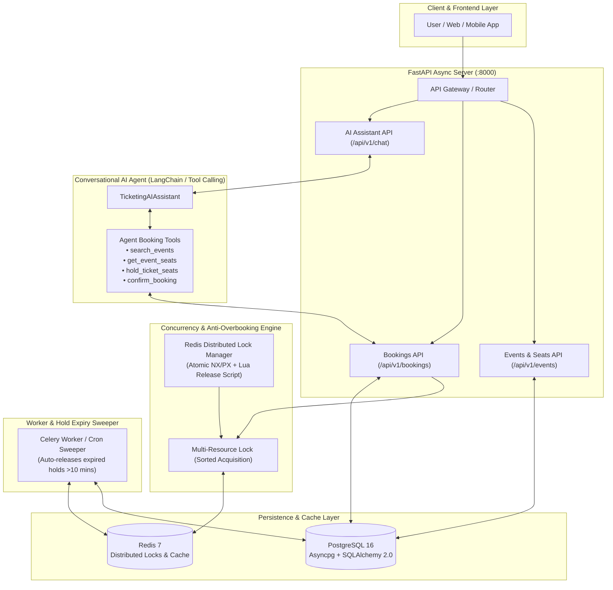

# 🎫 Member 3: Backend & AI Architect
### **AI-Powered Online Ticketing & Booking Assistant**

A high-performance, concurrency-resilient backend and conversational AI agent system built for real-time ticket reservations, anti-overbooking seat locking, and automated multi-turn booking conversations.

---

## 🏛️ System Architecture



---

## 🚀 Key Architectural Highlights

### 1. Concurrency Locks & Anti-Overbooking Logic
In high-demand ticketing (e.g. Coldplay, Taylor Swift, sports finals), multiple users or AI agents attempt to reserve the exact same seat simultaneously. 

To eliminate race conditions and guarantee **ZERO overbooking**, the system implements a two-tier defense:
1. **Redis Distributed Lock (`DistributedLock`)**:
   - Uses atomic `SET resource_key token NX PX {timeout}`.
   - Safe release via Lua script ensures a process only deletes its own lock.
   - **Deterministic Deadlock Prevention**: When reserving multiple seats (`multi_resource_lock`), keys are sorted alphabetically before acquisition, eliminating circular wait conditions.
2. **PostgreSQL Row-Level Locking (`SELECT ... FOR UPDATE`)**:
   - Inside the database transaction, target rows are locked to ensure atomic status transitions (`AVAILABLE` -> `HELD` -> `BOOKED`).
3. **Temporary Hold Window (10 Minutes)**:
   - Reserved seats are tagged with `hold_expires_at = now() + 10 mins` and status `HELD`.
   - If the user fails to complete checkout within 10 minutes, background sweeper tasks automatically release the seats back to `AVAILABLE`.

### 2. Conversational LLM Booking Agent
- Built with **LangChain & OpenAI / Gemini Tool Calling**.
- Users can naturally discover shows, view seat availability, place holds, and confirm bookings:
  - *"Find concerts in Mumbai this weekend"*
  - *"Show available VIP seats for Coldplay"*
  - *"Hold seat 1 for John Doe (john@example.com)"*
  - *"Confirm booking BKG-9F8A21C0"*
- Includes a **built-in intelligent fallback agent**, enabling testing and full end-to-end functionality even without third-party API keys configured.

### 3. Asynchronous PostgreSQL & SQLAlchemy 2.0
- Built on modern async DB patterns using `asyncpg` for connection-pooling high throughput.
- Full Alembic migration environment (`alembic.ini`, `alembic/env.py`).
- Normalized relational schema with audit timestamps:
  - `venues`, `events`, `seat_tiers`, `seats`, `users`, `bookings`, `booking_items`.

---

## 📂 Project Structure

```
d:\d\
├── app/
│   ├── main.py                    # FastAPI application, CORS, lifespan, sweeper
│   ├── core/
│   │   ├── config.py              # Pydantic Settings (.env loader)
│   │   ├── database.py            # Async SQLAlchemy engine & session factory
│   │   ├── redis.py               # Redis connection manager
│   │   └── locks.py               # Redis Distributed Lock & Redlock context manager
│   ├── models/                    # SQLAlchemy 2.0 Relational Models
│   │   ├── event.py               # Venue, Event, SeatTier
│   │   ├── seat.py                # Seat (Status: AVAILABLE, HELD, BOOKED)
│   │   ├── booking.py             # Booking, BookingItem
│   │   └── user.py                # User model
│   ├── schemas/                   # Pydantic Request & Response Schemas
│   │   ├── event.py
│   │   ├── seat.py
│   │   ├── booking.py
│   │   └── chat.py
│   ├── services/
│   │   ├── booking_service.py     # Concurrency-safe hold & confirmation logic
│   │   └── event_service.py       # Event search and seat availability queries
│   ├── agent/
│   │   ├── tools.py               # LLM Tools (search, seats, hold, confirm)
│   │   └── assistant.py           # Conversational Agent orchestrator
│   ├── api/v1/
│   │   ├── events.py              # /api/v1/events
│   │   ├── bookings.py            # /api/v1/bookings
│   │   └── chat.py                # /api/v1/chat
│   └── workers/
│       └── celery_worker.py       # Periodic Celery worker to sweep expired holds
├── scripts/
│   ├── seed_data.py               # Seeds mock venues, concerts, seats
│   └── run_concurrency_demo.py    # Stress test: 20 parallel requests for 1 seat
├── tests/
│   ├── conftest.py                # Pytest async fixtures
│   ├── test_concurrency_lock.py   # Automated race-condition tests
│   └── test_api.py                # API endpoint unit tests
├── docker-compose.yml             # Postgres 16, Redis 7, FastAPI, Celery
├── Dockerfile
├── alembic.ini
├── requirements.txt
└── .env.example
```

---

## ⚡ Quick Start & Deployment

### Option A: Run with Docker Compose (Recommended)
Start PostgreSQL, Redis, FastAPI backend, and Celery worker with one command:

```bash
docker compose up --build
```

- **Interactive API Documentation (Swagger)**: `http://localhost:8000/docs`
- **ReDoc Documentation**: `http://localhost:8000/redoc`
- **Health Check**: `http://localhost:8000/health`

---

### Option B: Local Python Development

1. **Install Dependencies**:
```bash
pip install -r requirements.txt
```

2. **Configure Environment**:
```bash
cp .env.example .env
```

3. **Seed Database with Events & Seats**:
```bash
python scripts/seed_data.py
```

4. **Start FastAPI Async Server**:
```bash
uvicorn app.main:app --host 0.0.0.0 --port 8000 --reload
```

---

## 🧪 Anti-Overbooking Concurrency Demonstration

Run the automated concurrency verification script to simulate 20 parallel users trying to book the same high-demand seat at the exact same millisecond:

```bash
python scripts/run_concurrency_demo.py
```

### Expected Output:
```text
================================================================================
🔥 ANTI-OVERBOOKING CONCURRENCY STRESS TEST (20 Parallel Contenders)
================================================================================
🎯 Target Seat: ID=1 (VIP-01) for Event ID=1
🚀 Firing 20 concurrent requests at the exact same millisecond...

📊 RESULTS BREAKDOWN:
--------------------------------------------------
  ✅ Contender #1: ACQUIRED_HOLD -> Ref: BKG-3A9F7B01
  🛡️ Contender #2: REJECTED_CONFLICT -> Conflict: Resource 'seat:1' is locked...
  🛡️ Contender #3: REJECTED_CONFLICT -> Conflict: Resource 'seat:1' is locked...
  ...
  🛡️ Contender #20: REJECTED_CONFLICT -> Conflict: Resource 'seat:1' is locked...
--------------------------------------------------
⏱️ Total Execution Time: 0.128 seconds
✅ Successful Holds: 1 (Expected: exactly 1)
🛡️ Gracefully Blocked: 19 (Expected: 19)

🎉 VERIFICATION PASSED: ZERO OVERBOOKING DETECTED!
Redis Distributed Lock and PostgreSQL row locking successfully prevented race conditions.
================================================================================
```

---

## 📡 API Reference Overview

| Method | Endpoint | Description | Concurrency Protected |
|---|---|---|---|
| `GET` | `/health` | Connectivity check for DB & Redis | No |
| `GET` | `/api/v1/events` | Search & filter scheduled events | No |
| `GET` | `/api/v1/events/{id}` | Event details and seat tiers | No |
| `GET` | `/api/v1/events/{id}/available-seats` | Real-time available seats list | No |
| `POST` | `/api/v1/bookings/hold` | Temporary 10-min seat hold | **Yes (Redis Lock + DB Lock)** |
| `POST` | `/api/v1/bookings/confirm` | Finalize payment & booking | **Yes (Redis Lock)** |
| `POST` | `/api/v1/bookings/{ref}/cancel`| Cancel booking and release seats | **Yes (Redis Lock)** |
| `GET` | `/api/v1/bookings/{ref}` | Retrieve booking status & tickets | No |
| `POST` | `/api/v1/chat` | AI Conversational Booking Concierge | **Yes (via Tool Calls)** |

---

## 🤖 Conversational AI Usage Example

Send a request to `/api/v1/chat`:
```json
{
  "message": "I'd like to book 2 VIP seats for Coldplay under Alex (alex@example.com)",
  "session_id": "session-101"
}
```

Response:
```json
{
  "reply": "Successfully held 2 seat(s)! Booking Reference: BKG-8F2C10E4. Total: $500.00. This hold expires in 10 minutes. Please confirm to finalize.",
  "session_id": "session-101",
  "action_taken": "hold_ticket_seats",
  "data": {
    "success": true,
    "booking_reference": "BKG-8F2C10E4",
    "status": "PENDING_PAYMENT",
    "total_amount": 500.0,
    "hold_expires_at": "2026-11-05T18:30:00Z"
  }
}
```
User confirmation:
```json
{
  "message": "Confirm booking BKG-8F2C10E4",
  "session_id": "session-101"
}
```
Response:
```json
{
  "reply": "🎉 Booking BKG-8F2C10E4 confirmed for 'Coldplay: Music of the Spheres World Tour'! E-tickets have been issued.",
  "session_id": "session-101",
  "action_taken": "confirm_booking"
}
```

